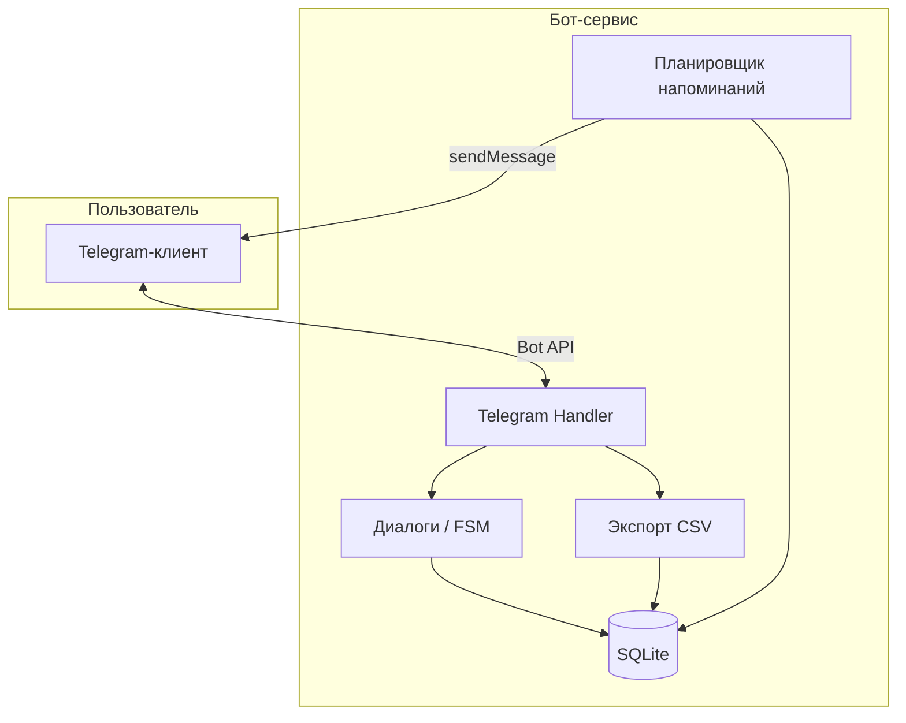
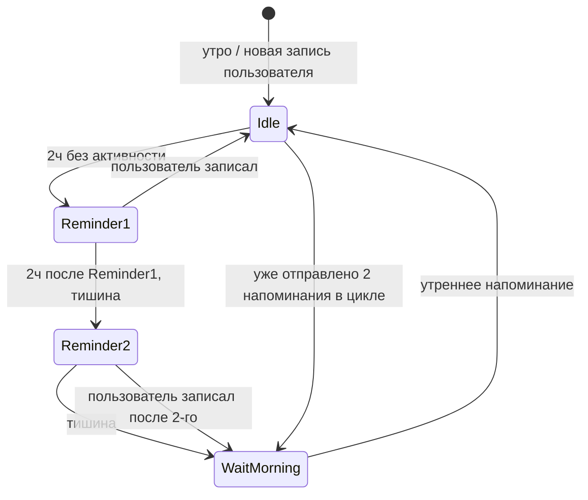

# Техническая архитектура MVP

> Telegram-бот «Режим питания по чувству голода»  
> Сверяться с: `CONTEXT.md`

---

## 1. Обзор

MVP — **один долгоживущий процесс** (бот-сервис), который:
- принимает сообщения и нажатия кнопок через Telegram Bot API;
- сохраняет записи в локальную БД;
- по расписанию отправляет напоминания;
- по запросу формирует CSV-файл для Excel.

Для одного пользователя **не нужны** облачные БД, очереди сообщений и платные API.



---

## 2. Стек (рекомендация)

| Слой | Технология | Почему |
|------|------------|--------|
| Язык | **Python 3.11+** | Простая работа с CSV, SQLite, быстрый MVP |
| Telegram | **aiogram 3.x** | Async, inline-кнопки, FSM для сценария «Поела» |
| БД | **SQLite** | Один файл, без сервера, достаточно для 1 пользователя |
| ORM / SQL | **SQLAlchemy 2** или чистый SQL | Структурированные модели, миграции при росте |
| Планировщик | **APScheduler** | Утреннее напоминание + периодическая проверка «2 часа без записей» |
| Конфиг | **python-dotenv** | Секреты в `.env`, не в коде |
| Экспорт | **stdlib `csv`** | CSV открывается в Excel без доп. библиотек |

Альтернатива (Node.js + Telegraf) возможна, но для MVP с акцентом на данные Python предпочтительнее.

---

## 3. Структура проекта

```
бот чувства голода/
├── CONTEXT.md
├── ARCHITECTURE.md
├── .env.example          # шаблон секретов (без реальных значений)
├── .gitignore
├── requirements.txt
├── README.md
├── data/
│   └── bot.db            # SQLite (в .gitignore)
├── exports/              # сгенерированные CSV (в .gitignore)
└── bot/
    ├── __main__.py       # точка входа
    ├── config.py         # загрузка настроек из .env
    ├── handlers/
    │   ├── start.py      # /start, главное меню
    │   ├── hunger.py     # запись голода
    │   ├── meal.py       # сценарий «Поела»
    │   └── export.py     # /export
    ├── keyboards/        # inline- и reply-клавиатуры
    ├── models/           # SQLAlchemy-модели
    ├── repositories/     # запросы к БД
    ├── services/
    │   ├── reminders.py  # логика «2 ч без записей»
    │   └── export_csv.py
    └── scheduler/        # задачи APScheduler
```

---

## 4. Компоненты

### 4.1 Telegram Handler

- Режим подключения: **long polling** (проще для MVP, не нужен домен и HTTPS).
- Доступ: **whitelist по Telegram user ID** — бот отвечает только вам, остальным — «бот недоступен».
- Интерфейс: **inline-кнопки** (0–10, тип приёма) + постоянное **reply-меню** («Голод», «Поела», «Экспорт»).

### 4.2 FSM — сценарий «Поела»

Короткий пошаговый диалог (≤3 нажатия после старта):

```
[Поела] → тип приёма → голод до (0–10) → сытость после (0–10) → сохранение → главное меню
```

Состояния FSM:
1. `MealStates.choose_type`
2. `MealStates.hunger_before`
3. `MealStates.satiety_after`

На любом шаге — кнопка «Отмена».

### 4.3 Запись голода

- Из главного меню или после напоминания.
- Одно нажатие: выбор 0–10 → сохранение с `timestamp` → подтверждение.

### 4.4 Планировщик напоминаний

**Утреннее напоминание**
- Cron-задача: каждый день в `WAKE_UP_TIME` (часовой пояс из конфига).
- Текст: см. `UI_COPY.md`.
- Сбрасывает inactivity-цикл (счётчик напоминаний за «день»).

**Inactivity-напоминания (2 шага)**

Проверка каждые **15 минут**.

**Активность** = запись голода **или** приёма пищи.  
`last_activity = max(last_hunger, last_meal)`.



| Шаг | Условие | Действие |
|-----|---------|----------|
| 1 | `now - last_activity ≥ 2h`, inactivity_count = 0 | Первое напоминание |
| 2 | inactivity_count = 1, `now - last_inactivity_reminder ≥ 2h`, нет записей после 1-го | Второе напоминание |
| — | inactivity_count ≥ 2 | Не слать до утреннего |
| Сброс | Новая запись голода/еды | inactivity_count = 0, новый отсчёт 2 ч |
| Сброс | Утреннее напоминание | inactivity_count = 0 |

**Тихие часы:** inactivity-напоминания не отправляются между `SLEEP_TIME` и `WAKE_UP_TIME`.  
Если первое напоминание попало в тихие часы — перенос на `WAKE_UP_TIME` (вместе с утренним не дублировать: одно утреннее сообщение).

### 4.5 Экспорт CSV

- Команда `/export` или кнопка «Выгрузить данные».
- Бот генерирует CSV и отправляет **документом** в чат.
- Колонки (единая таблица событий):

| Колонка | Описание |
|---------|----------|
| `id` | ID записи |
| `datetime` | ISO 8601 в вашем часовом поясе |
| `event_type` | `hunger` / `meal` |
| `hunger_level` | для hunger |
| `meal_type` | breakfast / snack / lunch / dinner |
| `hunger_before` | для meal |
| `satiety_after` | для meal |

Excel в Windows открывает UTF-8 CSV с BOM (`utf-8-sig`) — учесть при генерации.

---

## 5. Модель данных

### Таблица `settings` (одна строка)

| Поле | Тип | Описание |
|------|-----|----------|
| `wake_up_time` | TIME | Время утреннего напоминания, напр. `08:00` |
| `timezone` | TEXT | IANA, напр. `Europe/Kyiv` |

### Таблица `events`

| Поле | Тип | Описание |
|------|-----|----------|
| `id` | INTEGER PK | |
| `created_at` | DATETIME | UTC в БД; отображение — в local TZ |
| `event_type` | TEXT | `hunger` \| `meal` |
| `hunger_level` | INTEGER NULL | 0–10 |
| `meal_type` | TEXT NULL | breakfast, snack, lunch, dinner |
| `hunger_before` | INTEGER NULL | 0–10 |
| `satiety_after` | INTEGER NULL | 0–10 |

Индекс: `created_at` — для быстрых запросов «последняя активность» и экспорта.

### Таблица `reminder_log` (служебная)

| Поле | Тип | Описание |
|------|-----|----------|
| `id` | INTEGER PK | |
| `sent_at` | DATETIME | Когда отправлено |
| `reminder_type` | TEXT | `morning` \| `inactivity_1` \| `inactivity_2` |

По `inactivity_*` за текущий цикл (с последнего утра или сброса) определяется, сколько inactivity-напоминаний уже отправлено.

---

## 6. Команды и меню (MVP)

| Действие | Реализация |
|----------|------------|
| Старт / помощь | `/start` — приветствие + главное меню |
| Голод | Кнопка или `/hunger` → шкала 0–10 |
| Приём пищи | Кнопка «Поела» или `/meal` → FSM |
| Экспорт | `/export` → файл CSV |
| Настройка времени пробуждения | `/settings` → ввод времени (единственная настройка в MVP) |

---

## 7. Безопасность (MVP)

- `BOT_TOKEN` и `ALLOWED_USER_ID` — только в `.env`, файл в `.gitignore`.
- Бот не принимает команды от других user ID.
- БД и экспорты — локально на машине/сервере, где крутится бот.
- Резервная копия: периодически скачивать CSV через `/export` (ручной бэкап достаточен для MVP).

---

## 8. Деплой

### Вариант A — локально (разработка и первые недели)

- Бот запущен на вашем ПК: `python -m bot`.
- Плюсы: бесплатно, просто.
- Минусы: напоминания работают **только когда ПК включён и бот запущен**.

### Вариант B — VPS (рекомендуется для постоянных напоминаний)

- Недорогий VPS (Hetzner, Timeweb, Selectel и т.п.).
- Бот как **systemd-сервис** — автозапуск и перезапуск при падении.
- Polling, без домена.
- Ориентир: **€3–5 / мес** или аналог в рублях.

### Вариант C — домашний always-on сервер

- Raspberry Pi / старый ноутбук — аналог VPS, без абонплаты облака.

**Webhook не нужен** для MVP — polling проще и надёжен при одном пользователе.

---

## 9. Что отложено технически (не MVP)

- PostgreSQL / облачная БД
- Webhook + домен + SSL
- Мультипользователь и авторизация
- Веб-дашборд для аналитики
- Автоматический еженедельный бэкап в облако
- Docker (можно добавить позже для деплоя)

---

## 10. Чеклист: что нужно от вас

### Обязательно (бесплатно)

| # | Что | Как получить |
|---|-----|--------------|
| 1 | **Аккаунт Telegram** | Уже есть |
| 2 | **Bot Token** | @BotFather → `/newbot` → имя и username → скопировать токен |
| 3 | **Ваш Telegram User ID** | Написать @userinfobot или @getmyid_bot → числовой ID |
| 4 | **Время пробуждения** | Например, `08:00` |
| 5 | **Часовой пояс** | IANA-формат, напр. `Europe/Kyiv`, `Europe/Moscow` |

### Для разработки на вашем ПК

| # | Что | Примечание |
|---|-----|------------|
| 6 | **Python 3.11+** | [python.org](https://www.python.org/downloads/) |
| 7 | **Git** (желательно) | Для версионирования |

### Для работы 24/7 (когда перейдёте с локального запуска)

| # | Что | Примечание |
|---|-----|------------|
| 8 | **VPS или always-on устройство** | ~€3–5/мес или свой сервер |
| 9 | **SSH-доступ к VPS** | Логин/ключ — для деплоя (можно настроить позже) |

### Не нужно для MVP

- Платные API (OpenAI и т.п.)
- Подписка на облачную БД
- Доменное имя
- SSL-сертификат
- Telegram Premium
- BotFather платных функций

---

## 11. Файл `.env` (шаблон)

```env
BOT_TOKEN=123456789:ABCdefGHIjklMNOpqrsTUVwxyz
ALLOWED_USER_ID=123456789
WAKE_UP_TIME=08:00
TIMEZONE=Europe/Kyiv
# опционально, для тихих часов:
# SLEEP_TIME=23:00
```

---

## 12. Порядок разработки

1. Каркас бота: `/start`, whitelist, главное меню
2. Запись голода (0–10)
3. FSM «Поела» + сохранение в SQLite
4. Утреннее напоминание
5. Inactivity-напоминания (2 шага + пауза до утра)
6. `/export` → CSV
7. `/settings` — время пробуждения
8. README: установка, запуск, деплой на VPS

---

## История

| Дата | Событие |
|------|---------|
| 2026-07-23 | Первая версия архитектуры MVP |
